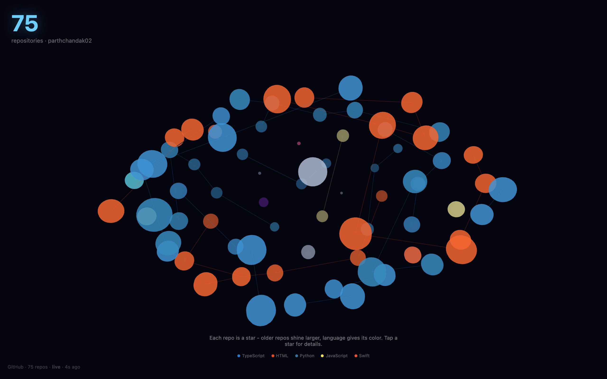

<div align="center">

<h1>Stellar</h1>

<p><b>A GitHub account drawn as a star map.</b></p>

<p><i>Every public repo is a star, coloured by its language and linked to its nearest same-language neighbour.</i></p>

<h6>


</h6>

<a href="https://stellar.parthchandak.info"><b>Live demo</b></a> ·
<a href="#how-it-works"><b>How it works</b></a> ·
<a href="#run-it"><b>Run it</b></a>

<br><br>

<a href="https://stellar.parthchandak.info"></a>

<sub>Live capture, 22 October 2026. Real GitHub data: 75 public repositories.</sub>

</div>

<br>

The page asks the public GitHub API for the account's repositories (up to 100, forks left out)
and places each one on a flattened sphere using a golden-angle spiral, so the stars spread evenly.
The camera slowly orbits. It re-fetches every 60 seconds; unauthenticated requests need no token.

## How it works

| Repo field | Drives |
|---|---|
| `language` | Star colour, using GitHub's own language colours; the five most common appear in the legend |
| `created_at` | Star size, scaled between the oldest and newest repo; newer repos come out larger |
| `pushed_at` | Pulse speed: repos pushed in the last year pulse faster the more recent the push |
| `language` (again) | Each star draws a faint line to its nearest neighbour of the same language, if one is close enough |

Drag to orbit, scroll to zoom. Click a star and a card shows the repo name, creation date, days
since the last push and its description, while every other star and other languages' lines dim; it fades after four
seconds. If the API call fails, or hits GitHub's unauthenticated rate limit, a built-in list of 17
repos is shown and the stamp bottom-left reads `fallback` instead of `live`.

## Run it

```bash
git clone https://github.com/parthchandak02/stellar.git
cd stellar
npm install
npm run dev      # local dev server
npm run build    # type-check, then static site in dist/
```

To map a different account, change `API_URL` in `src/data/repos.ts` and the label in
`src/components/HeroStats.tsx`. The live version runs on Cloudflare Pages.

<details>
<summary><b>Project layout</b></summary>

```
src/App.tsx                          Canvas, camera, polling, overlays
src/data/repos.ts                    GitHub fetch and fallback list
src/utils/positionStars.ts           Spiral placement, star size, constellation edges
src/utils/languageColors.ts          Language colours and palette
src/components/Star.tsx              One star: colour, pulse, click
src/components/ConstellationLines.tsx Same-language lines
src/components/QuietZone.tsx         The repo detail card
```

</details>

<br>

<div align="center">
<sub>Built with React Three Fiber, drei, Three.js and Vite. Data from the GitHub REST API.</sub>
</div>
